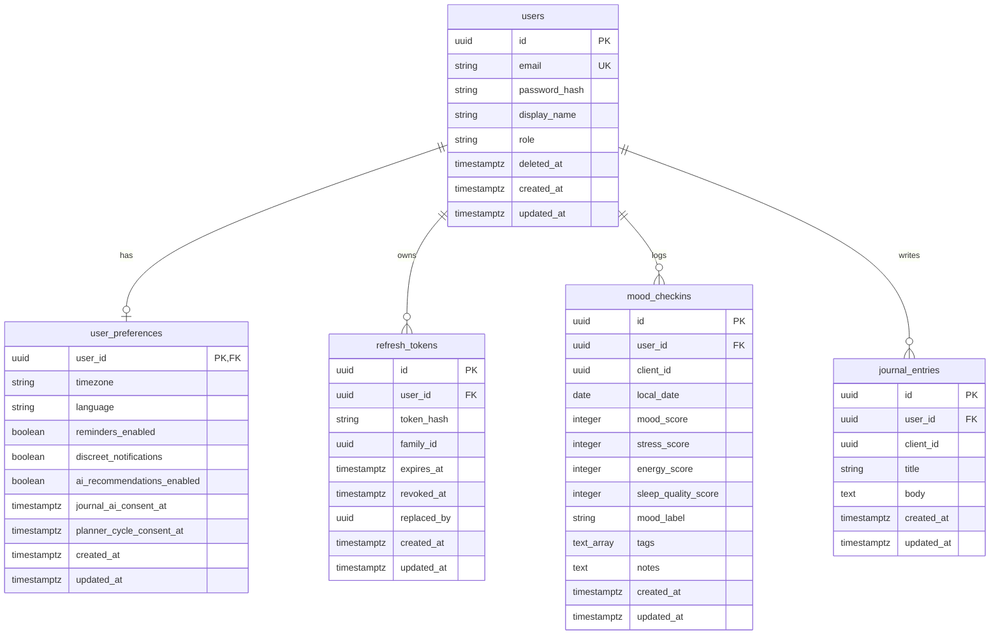

# BloomWell Database ERD

## Entity-Relationship Diagram

## Table Specifications

### 1. `users`
- Primary system-of-record for student accounts.
- Cascades deletion to all private tables on account removal.

### 2. `user_preferences`
- User-scoped preferences and consent timestamps.
- Separates consent flags (`journal_ai_consent_at`, `planner_cycle_consent_at`) from operational preferences.

### 3. `refresh_tokens`
- Hashed refresh tokens for JWT rotation.
- Tracks `family_id` to detect token reuse and trigger immediate revocation.

### 4. `mood_checkins`
- Daily mood and wellness check-in records.
- **Constraints & Indexes**:
  - Primary Key: `id` (UUID).
  - Foreign Key: `user_id` -> `users.id` with `ON DELETE CASCADE`.
  - Unique: `(user_id, client_id)` for client-driven request idempotency.
  - Indexes: `ix_mood_checkins_user_id_local_date`, `ix_mood_checkins_user_id_created_at`.
  - Score Checks: `mood_score`, `stress_score`, `energy_score` between 1 and 5; `sleep_quality_score` nullable, between 1 and 5 when provided.
  - **Schema note on `mood_label`**: `mood_label` (nullable String/Enum: `happy`, `calm`, `okay`, `sad`, `stressed`) is added alongside `mood_score` (1-5) as a small enhancement to the original README schema to allow direct mapping with the 5 discrete mood options in the BloomWell Home and Mood screen UI.

### 5. `journal_entries`
- Private student journal reflections.
- **Constraints & Indexes**:
  - Primary Key: `id` (UUID).
  - Foreign Key: `user_id` -> `users.id` with `ON DELETE CASCADE`.
  - Unique: `(user_id, client_id)` for idempotency.
  - Index: `ix_journal_entries_user_id_created_at`.
  - Field Constraints: `title` max 120 chars; `body` required, 1 to 10,000 chars.
