# BloomWell Database ERD

## Entity-Relationship Diagram

```mermaid
erDiagram
    users ||--o| user_preferences : "has"
    users ||--o{ refresh_tokens : "owns"
    users ||--o{ mood_checkins : "logs"
    users ||--o{ journal_entries : "writes"
    users ||--o{ academic_events : "records"
    users ||--o{ cycle_logs : "records"
    users ||--o{ user_activity_logs : "completes"
    activities ||--o{ user_activity_logs : "tracks"
    users ||--o{ study_plans : "receives"
    study_plans ||--o{ study_plan_items : "contains"
    academic_events ||--o{ study_plan_items : "informs"
    activities ||--o{ study_plan_items : "suggests"
    resources ||--o{ resource_reports : "receives"
    users ||--o{ resource_reports : "submits"
    users ||--o{ account_events : "logs"

    users {
        uuid id PK
        string email UK
        string password_hash
        string display_name
        string role "CHECK role IN ('student', 'moderator', 'resource_admin')"
        timestamptz deleted_at
        timestamptz created_at
        timestamptz updated_at
    }

    resources {
        uuid id PK
        string name
        string category "counseling, helpline, welfare_office, period_products, ngo, health_clinic, workshop"
        string description
        string phone
        string email
        string website_url
        string address
        string city
        string hours_text
        boolean available_24x7
        text_array languages
        string cost "free, paid, unknown"
        jsonb product_details
        string source_url
        string verification_status "unverified, verified, outdated"
        date last_verified_at
        string verified_by
        boolean is_published
        boolean is_demo
        timestamptz created_at
        timestamptz updated_at
    }

    resource_reports {
        uuid id PK
        uuid resource_id FK
        uuid reporter_id FK
        string reason "outdated, out_of_order, incorrect, closed, other"
        string note
        string status "open, resolved, dismissed"
        timestamptz created_at
        timestamptz resolved_at
        string resolved_note
    }

    education_resources {
        uuid id PK
        string slug UK
        string title
        string category "periods_basics, hygiene, common_symptoms, when_to_seek_care, emotional_wellbeing, supporting_someone"
        string language UK
        string summary
        text body
        string source_name
        string source_url
        string review_status "draft, reviewed"
        date reviewed_at
        boolean is_published
        timestamptz created_at
        timestamptz updated_at
    }

    user_preferences {
        uuid user_id PK, FK
        string timezone
        string language
        boolean reminders_enabled
        boolean discreet_notifications
        boolean ai_recommendations_enabled
        boolean cycle_tracking_enabled
        timestamptz cycle_tracking_consent_at
        timestamptz journal_ai_consent_at
        timestamptz planner_cycle_consent_at
        timestamptz created_at
        timestamptz updated_at
    }

    refresh_tokens {
        uuid id PK
        uuid user_id FK
        string token_hash
        uuid family_id
        timestamptz expires_at
        timestamptz revoked_at
        uuid replaced_by
        timestamptz created_at
        timestamptz updated_at
    }

    mood_checkins {
        uuid id PK
        uuid user_id FK
        uuid client_id
        date local_date
        integer mood_score
        integer stress_score
        integer energy_score
        integer sleep_quality_score
        string mood_label
        text_array tags
        text notes
        timestamptz created_at
        timestamptz updated_at
    }

    journal_entries {
        uuid id PK
        uuid user_id FK
        uuid client_id
        string title
        text body
        timestamptz created_at
        timestamptz updated_at
    }

    academic_events {
        uuid id PK
        uuid user_id FK
        string title
        date event_date
        string event_type
        timestamptz created_at
        timestamptz updated_at
    }

    activities {
        uuid id PK
        string title
        string category
        integer duration_minutes
        text content
        string language
        string source
        boolean is_published
        timestamptz created_at
        timestamptz updated_at
    }

    user_activity_logs {
        uuid id PK
        uuid user_id FK
        uuid activity_id FK
        timestamptz completed_at
        integer helpfulness_rating
        boolean is_favorite
        timestamptz created_at
        timestamptz updated_at
    }

    cycle_logs {
        uuid id PK
        uuid user_id FK
        date period_start
        date period_end
        timestamptz created_at
        timestamptz updated_at
    }

    study_plans {
        uuid id PK
        uuid user_id FK
        date week_start
        integer days
        string mode
        boolean uses_cycle_data
        integer checkin_days_used
        timestamptz created_at
    }

    study_plan_items {
        uuid id PK
        uuid study_plan_id FK
        date plan_date
        string suggested_load
        text_array reason_codes
        uuid academic_event_id FK
        uuid activity_id FK
        string status
        timestamptz updated_at
    }

    account_events {
        uuid id PK
        uuid user_id FK
        string event_type "export_requested, password_changed, sessions_revoked, cycle_data_deleted, consent_changed"
        timestamptz created_at
    }
```

## Table Specifications

### 1. `users`
- Primary system-of-record for student accounts.
- Cascades deletion to all private tables on account removal.

### 2. `user_preferences`
- User-scoped preferences and consent timestamps.
- Separates consent flags (`cycle_tracking_enabled`, `cycle_tracking_consent_at`, `journal_ai_consent_at`, `planner_cycle_consent_at`) from operational preferences.

### 3. `refresh_tokens`
- Hashed refresh tokens for JWT rotation.
- Tracks `family_id` to detect token reuse and trigger immediate revocation.

### 4. `mood_checkins`
- Daily mood and wellness check-in records.
- **Constraints & Indexes**:
  - Primary Key: `id` (UUID).
  - Foreign Key: `user_id` -> `users.id` with `ON DELETE CASCADE`.
  - Unique: `(user_id, client_id)` for client-driven request idempotency.
  - Indexes: `ix_mood_checkins_user_id_local_date`, `ix_mood_checkins_user_id_created_at`.
  - Score Checks: `mood_score`, `stress_score`, `energy_score` between 1 and 5; `sleep_quality_score` nullable, between 1 and 5 when provided.
  - **Schema note on `mood_label`**: `mood_label` (nullable String/Enum: `happy`, `calm`, `okay`, `sad`, `stressed`) is added alongside `mood_score` (1-5) as a small enhancement to allow direct mapping with discrete mood options in the BloomWell UI.

### 5. `journal_entries`
- Private student journal reflections.
- **Constraints & Indexes**:
  - Primary Key: `id` (UUID).
  - Foreign Key: `user_id` -> `users.id` with `ON DELETE CASCADE`.
  - Unique: `(user_id, client_id)` for idempotency.
  - Index: `ix_journal_entries_user_id_created_at`.
  - Field Constraints: `title` max 120 chars; `body` required, 1 to 10,000 chars.

### 6. `academic_events`
- Student-entered exams and assignment deadlines used by the Study Planner and exam-context insights.
- **Constraints & Indexes**:
  - Primary Key: `id` (UUID).
  - Foreign Key: `user_id` -> `users.id` with `ON DELETE CASCADE`.
  - Indexes: `ix_academic_events_user_id`, `ix_academic_events_user_id_event_date`.
  - Field Constraints: `title` max 120 chars; `event_type` default `'exam'`.

### 7. `activities`
- Curated wellness and study-break activity catalog.
- **Constraints & Indexes**:
  - Primary Key: `id` (UUID).
  - Indexes: `ix_activities_category`, `ix_activities_is_published`.
  - Field Constraints: `title` max 150 chars; `category` max 50 chars; `language` default `'en'`.

### 8. `user_activity_logs`
- User completion, helpfulness rating, and favorite status for activities.
- **Constraints & Indexes**:
  - Primary Key: `id` (UUID).
  - Foreign Keys: `user_id` -> `users.id` (`ON DELETE CASCADE`), `activity_id` -> `activities.id` (`ON DELETE CASCADE`).
  - Indexes: `ix_user_activity_logs_user_id`, `ix_user_activity_logs_user_id_activity_id`.

### 9. `cycle_logs`
- Recorded menstrual cycle period start and end dates.
- Incomplete records (start date without end date) are fully supported.
- **Constraints & Indexes**:
  - Primary Key: `id` (UUID).
  - Foreign Key: `user_id` -> `users.id` with `ON DELETE CASCADE`.
  - Index: `ix_cycle_logs_user_id_period_start`.

### 10. `study_plans`
- Generated 7-day study schedule suggestions balancing user energy trends and exam calendars.
- **Constraints & Indexes**:
  - Primary Key: `id` (UUID).
  - Foreign Key: `user_id` -> `users.id` with `ON DELETE CASCADE`.
  - Unique: `(user_id, week_start)` ensures at most one plan per user per week.
  - Index: `ix_study_plans_user_id_week_start`.
  - Check Constraint: `mode IN ('default', 'personalized')`.
  - Field: `uses_cycle_data` tracks whether consented cycle data informed the plan.

### 11. `study_plan_items`
- Daily suggested load and break activities for each day of the study plan.
- **Constraints & Indexes**:
  - Primary Key: `id` (UUID).
  - Foreign Key: `study_plan_id` -> `study_plans.id` with `ON DELETE CASCADE`.
  - Foreign Key: `academic_event_id` -> `academic_events.id` with `ON DELETE SET NULL`.
  - Foreign Key: `activity_id` -> `activities.id` with `ON DELETE SET NULL`.
  - Unique: `(study_plan_id, plan_date)`.
  - Indexes: `ix_study_plan_items_study_plan_id`, `ix_study_plan_items_plan_date`.
  - Check Constraints: `suggested_load IN ('light', 'normal', 'focus')`, `status IN ('suggested', 'accepted', 'edited', 'skipped')`.
  - Field: `reason_codes` stores explainable observation tokens mapped to localized strings on mobile.

### 12. `resources`
- Verified campus and community resources, helplines, counseling centers, and period-product access points (HelpHub).
- **Constraints & Indexes**:
  - Primary Key: `id` (UUID).
  - Indexes: `ix_resources_category_city` on `(category, city)`, `ix_resources_is_published` on `(is_published)`.
  - Check Constraint `ck_resources_category`: `category IN ('counseling', 'helpline', 'welfare_office', 'period_products', 'ngo', 'health_clinic', 'workshop')`.
  - Check Constraint `ck_resources_cost`: `cost IN ('free', 'paid', 'unknown')`.
  - Check Constraint `ck_resources_verification_status`: `verification_status IN ('unverified', 'verified', 'outdated')`.
  - Check Constraint `ck_resources_published_verified`: `NOT (is_published = true AND is_demo = false) OR (verification_status = 'verified' AND source_url IS NOT NULL AND last_verified_at IS NOT NULL)`.
  - Check Constraint `ck_resources_24x7_verified`: `available_24x7 IS NOT TRUE OR (verification_status = 'verified' AND source_url IS NOT NULL)`.
  - Fields: `product_details` (JSONB) stores items (`pads`, `cups`, `disposal`), access instructions; `languages` (text array).

### 13. `resource_reports`
- User-submitted reports on broken, empty, outdated, or closed resource access points.
- **Constraints & Indexes**:
  - Primary Key: `id` (UUID).
  - Foreign Key: `resource_id` -> `resources.id` with `ON DELETE CASCADE`.
  - Foreign Key: `reporter_id` -> `users.id` with `ON DELETE SET NULL` (account deletion blanks the person but retains the community report).
  - Partial Unique Index: `uq_resource_reports_open` on `(reporter_id, resource_id)` WHERE `status = 'open'`.
  - Check Constraints: `reason IN ('outdated', 'out_of_order', 'incorrect', 'closed', 'other')`, `status IN ('open', 'resolved', 'dismissed')`.
  - Privacy: Admin read responses strictly exclude `reporter_id` and reporter identity.

### 14. `education_resources`
- Reviewed educational content covering menstrual basics, hygiene, comfort, when to seek care, and peer support.
- **Constraints & Indexes**:
  - Primary Key: `id` (UUID).
  - Unique: `(slug, language)` guarantees at most one article per slug per language.
  - Indexes: `ix_education_category_language` on `(category, language)`, `ix_education_is_published` on `(is_published)`.
  - Check Constraints: `category IN ('periods_basics', 'hygiene', 'common_symptoms', 'when_to_seek_care', 'emotional_wellbeing', 'supporting_someone')`, `language IN ('en', 'hi', 'mr')`, `review_status IN ('draft', 'reviewed')`.
  - Integrity: Plain text body only (no HTML); starts as `draft` with `BloomWell team draft` source; must include doctor consult note.

### 15. `account_events`
- User-visible audit trail of sensitive account and privacy operations.
- **Constraints & Indexes**:
  - Primary Key: `id` (UUID).
  - Foreign Key: `user_id` -> `users.id` with `ON DELETE CASCADE` (audit log permanently disappears when the user account is deleted).
  - Index: `ix_account_events_user_id_created_at` on `(user_id, created_at)` for efficient cursor pagination (newest first).
  - Enum: `event_type IN ('export_requested', 'password_changed', 'sessions_revoked', 'cycle_data_deleted', 'consent_changed')`.
  - Privacy: Contains only event type and created timestamp. Strictly no request payloads, IP addresses, or device info.
